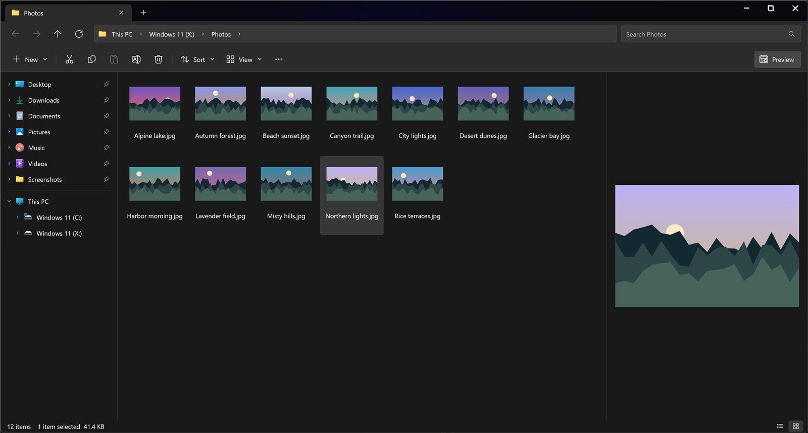

# explorer-app

Explorer App for Windows: a fast file explorer that looks and feels like Windows 11 File Explorer, without the wait.

Native Win32 + Direct2D + the real Windows shell, in Rust: an under-1 MB exe with instant search across your drives.




## Download

From the [latest release](https://github.com/sidx1024/explorer-app/releases/latest) (Windows 10 1903+ / Windows 11, x64):

- **`explorer-app-<version>-x64.msi`**: the installer (recommended). Installs for your user only, with no admin prompt. It adds Explorer App to the Start menu and *Open in Explorer App* to the context menu of folders and drives. Uninstall from Settings > Apps > Installed apps; installing a newer version upgrades in place.
- **`explorer-app.exe`**: portable, a single exe with nothing to install.

`SHA256SUMS.txt` on the release lets you verify the download. The files aren't code-signed yet, so Windows SmartScreen may say "Windows protected your PC" the first time: choose **More info → Run anyway**.

## Features

- **Windows 11 look:** tabs in the title bar, Mica, Fluent icons, Snap Layouts, light/dark/high contrast, per-monitor DPI, and the real shell icons and file type names.
- **Instant search:** a live index of every fixed drive, without admin rights, answers in milliseconds as you type. Space-separated words must all match, `*`/`?` are wildcards, and a word containing `\` matches the path. *Search options* filter by subfolders, date modified, type, size and system files.
- **Views:** extra large to small icons, list, details (sortable, resizable columns; double-click a column edge to autofit) and tiles with drive usage. Ctrl+mouse wheel changes size.
- **Thumbnails** for anything Windows can preview (photos, videos, PDFs...), cached in `thumbs26.db` so folders open instantly next time. Windows' own `Thumbs.db` is never touched.
- **Per-folder memory:** view, sort order and column widths are remembered per folder; mostly-media folders open in Large icons.
- **Preview pane** (Alt+P): images, text and code, plus the same preview handlers File Explorer uses (PDF, Office...).
- **Navigation:** back/forward/up, breadcrumbs with subfolder dropdowns, an editable address bar (`%VARS%`, relative paths), Quick access shared with File Explorer's pins, This PC and drives, live refresh.
- **Files:** the full Windows context menu with your installed extensions, New folder / Text document, inline rename, cut/copy/paste, delete to the Recycle Bin (Shift+Del permanently), Properties, Open in Terminal, and drag & drop in both directions, with Windows' own progress and conflict dialogs.
- **No AI features:** no cloud, no accounts, no telemetry. See [PRIVACY.md](PRIVACY.md).

## Keyboard

| Keys | Action |
|---|---|
| Alt+←/→/↑, Backspace, mouse back/forward | Back / Forward / Up |
| Ctrl+L, Alt+D, F4 | Edit address |
| Ctrl+F, Ctrl+E, F3 | Search |
| Ctrl+T / Ctrl+W / Ctrl+Tab | New / close / switch tab |
| Ctrl+N / Ctrl+Shift+N | New window / new folder |
| F2, F5, Del, Shift+Del | Rename, refresh, recycle, delete permanently |
| Ctrl+A/C/X/V, Alt+Enter | Select all, copy, cut, paste, properties |
| Alt+P | Preview pane |
| Ctrl+Shift+1…7 | Extra large, large, medium, small, list, details, tiles |
| Menu key, Shift+F10 | Context menu |

## Settings

Most settings are in the ··· menu, View menu and Search options. Everything is stored in `%LOCALAPPDATA%\Explorer App`:

- `config.ini`: global settings, human-editable. `thumbnail_store=central|folder` chooses whether `thumbs26.db` files live in `%LOCALAPPDATA%\Explorer App\folders` (the default) or hidden inside each folder. `index_drives=false` turns off the search index.
- `folders\`: thumbnails and per-folder view settings.
- `index\`: the instant-search index.

## Build

Requires Rust (MSVC toolchain) and the Windows SDK (for `rc.exe`, used to embed the icon and version).

```
cargo build --release
```

The binary is `target\release\explorer-app.exe`. Run it with an optional folder (or file, to select it) as the argument.

## Tests

```
cargo test --release
```

## Packaging

- **MSI installer** ([WiX Toolset](https://wixtoolset.org) v5, per-user): `dotnet tool install --global wix --version 5.0.2`, then `.\packaging\build-msi.ps1`.
- **MSIX package** (Microsoft Store): `.\packaging\build-msix.ps1` (needs the Windows SDK).
- **Icons and logos:** `.\packaging\make-assets.ps1` regenerates `assets\explorer-app.ico` and the MSIX logos.

### Publishing to the Microsoft Store

1. Reserve the name *Explorer App* (or another) in [Partner Center](https://partner.microsoft.com/dashboard) and open **Product identity**.
2. Set the repository variables `MSIX_IDENTITY_NAME` (Package/Identity/Name), `MSIX_PUBLISHER` (Package/Identity/Publisher, `CN=…`) and `MSIX_PUBLISHER_DISPLAY_NAME` (plus `MSIX_DISPLAY_NAME` if you reserved a different name), or pass them to `build-msix.ps1` as `-IdentityName`, `-Publisher`, `-PublisherDisplayName` and `-DisplayName`.
3. Upload the `explorer-app-store-msix` artifact from the release workflow run as the submission's package. The Store signs it. The app declares the `runFullTrust` capability (every packaged Win32 app does), which the submission asks you to justify; the text is in [`packaging/store-listing.md`](packaging/store-listing.md), along with the listing, screenshots and age-rating answers.
4. Optionally check it locally first with the Windows App Certification Kit (`appcert.exe`, in the Windows SDK; run as administrator).

## Releasing

Bump `version` in `Cargo.toml` (the exe's version info follows it), commit, then tag and push. GitHub Actions builds and tests, publishes the release (`explorer-app.exe`, the MSI, a zip and checksums) and attaches the Store MSIX to the workflow run:

```
git tag v1.0.0
git push origin v1.0.0
```

## Design

See [docs/ARCHITECTURE.md](docs/ARCHITECTURE.md) for the architecture, the `thumbs26.db` format, the search index, and the plan for web access.
